
# Finding the Game — Search Process Study

**CHIIR 2027 · Post-play game identification · Report generated 2026-08-19**

This report ties together the study background, dataset, and results so far.
Full methodological detail and literature comparisons live in
[`docs/planning_and_background.md`](../docs/planning_and_background.md);
analysis code lives in [`analysis/`](../analysis); raw outputs in
[`results/`](../results).

**Jump to:** [Study & method](#study) · [RQ1](#rq1) · [RQ2](#rq2) ·
[RQ3](#rq3) · [RQ4](#rq4) · [RQ5](#rq5) · [RQ6](#rq6) · [RQ7](#rq7) ·
[RQ8](#rq8) · [RQ10](#rq10) · [RQ11](#rq11) · [Discussion](#discussion) ·
[Status & next steps](#status)

## 1. Study & method

21 participants each played two games (order rotated) and were then given up
to 10 minutes per game to find that game's name using whatever search
strategy they liked. Screen activity was annotated by human coders into a
controlled 8-value action vocabulary: `Query`, `View result list`,
`View single result`, `Platform switch`, `View AI response`,
`View info box`, `Browsing`, and `Experiment ended` (a per-task end marker,
not a search action). 4 annotators coded the sessions. Two columns added
later (`action_details_clean`, `action_details_num_tokens` — destination
platform/source site and query/text length; see §8) enrich `Query`,
`Platform switch`, and `View single result` rows specifically.

**Data cleaning applied:** the duplicate `Experiment ended` marker
previously flagged for `ID12` was fixed by the annotator at the source.
An earlier data refresh (the one that added the two new columns) had
introduced an Excel `#REF!` error in `ID12`'s `rank` column for 3 rows —
also now fixed at the source (`analysis/data.py` still carries a
fallback repair for any future recurrence, see
[`docs/planning_and_background.md`](../docs/planning_and_background.md)
§4.7). `ID1` and `ID20`'s added events are confirmed genuine
re-annotation corrections. `ID3`'s Best Buds session gained 4 further
`Platform switch` events in a later annotation pass. This is now the
final, stable dataset: **1,302 events** across 21 participants × 2
games, and every table below reflects it — no further data-refresh
caveats.

[↑ Back to top](#top)

## 2. RQ1 — How common are the actions individually?

### 2.1 Overall frequency

| Action | Count | Share |
|---|---:|---:|
| View result list | 359 | 27.6% |
| Query | 326 | 25.0% |
| Platform switch | 240 | 18.4% |
| View single result | 158 | 12.1% |
| View AI response | 81 | 6.2% |
| View info box | 52 | 4.0% |
| Browsing | 44 | 3.4% |
| Experiment ended | 42 | 3.2% |

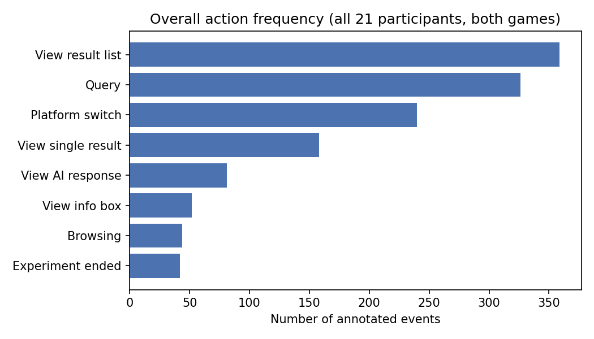

`Query` and `View result list` dominate, as expected for search tasks.
`Platform switch` is the third most common action overall (18%) — notably
frequent for a "find one thing" task, suggesting participants often check
more than one store/platform rather than committing to a single search
surface.

### 2.2 By game

| Action | Best Buds vs Bad Guys | Townscaper |
|---|---:|---:|
| View result list | 28.7% | 24.7% |
| Query | 26.1% | 22.2% |
| Platform switch | 18.7% | 17.7% |
| View single result | 10.2% | 17.2% |
| View AI response | 6.7% | 5.0% |
| View info box | 4.4% | 3.0% |
| Browsing | 3.0% | 4.4% |
| Experiment ended | 2.2% | 5.8% |

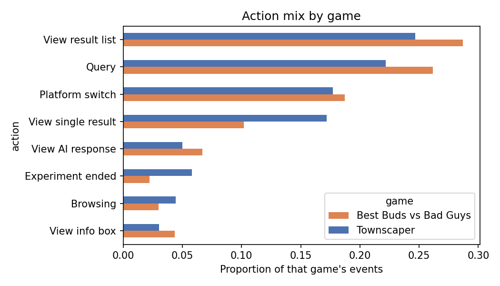

The action *mix* is broadly similar, but `View single result` is
proportionally much more common in Townscaper (17% vs. 10%) — consistent
with Townscaper being the task participants actually solved: they land on
one correct result and stop, rather than continuing to cycle through result
lists.

### 2.3 Session length by game

Search-only event counts per participant (excludes `Experiment ended`):

| Game | Mean | Median | Min | Max |
|---|---:|---:|---:|---:|
| Best Buds vs Bad Guys | 43.8 | 47 | 13 | 71 |
| Townscaper | 16.2 | 13 | 4 | 55 |

**Success split: 20 of 21 participants found Townscaper (usually quickly);
0 of 21 found Best Buds vs Bad Guys within the 10-minute cap.** The volume
and length difference above isn't just "Best Buds is harder" — every Best
Buds session is a search that ran out the clock unresolved, while
Townscaper sessions are (almost all) resolved searches, often in very few
steps. This reframes RQ3: the comparison isn't between two similarly-solved
tasks, but between a resolved-search regime and a uniformly
unresolved-search regime. (One Townscaper outlier ran to 55 events despite
the task usually being solved fast — worth a closer look when we get to
per-participant analysis.)

[↑ Back to top](#top)

## 3. RQ2 — Typical action patterns or sequences?

**Data fix found along the way:** building the transition matrix assumes
`Experiment ended` is a true absorbing end-state (no actions after it). One
session (`ID10`, Townscaper) had a `Platform switch` recorded *after*
`Experiment ended` — likely a stray post-task event. `analysis/data.py` now
truncates anything after the end marker per (participant, game), dropping 1
event from the pipeline (the 1,302-event total in §1 already reflects this).
See
[`docs/planning_and_background.md`](../docs/planning_and_background.md) §6.

### 3.1 The core search loop

First-order transition probabilities (`results/rq2/transitions_probs_overall.csv`),
visualized in [`results/rq2/transition_graph_overall.png`](../results/rq2/transition_graph_overall.png):

| From → | Most likely next action(s) |
|---|---|
| Query | View result list (60%) |
| View result list | Query (30%) · View single result (29%) · Platform switch (24%) |
| Platform switch | Query (55%) · View result list (35%) |
| View AI response | Query (42%) |
| Experiment ended | *(none — confirmed absorbing)* |

The backbone is a tight loop: **Query → View result list**, which then
splits three ways (reformulate, drill into a result, or switch platform).
`Platform switch` and `View AI response` both function as *detours back
into* the loop rather than endpoints — over half of platform switches and
40%+ of AI-response views are immediately followed by another `Query`.

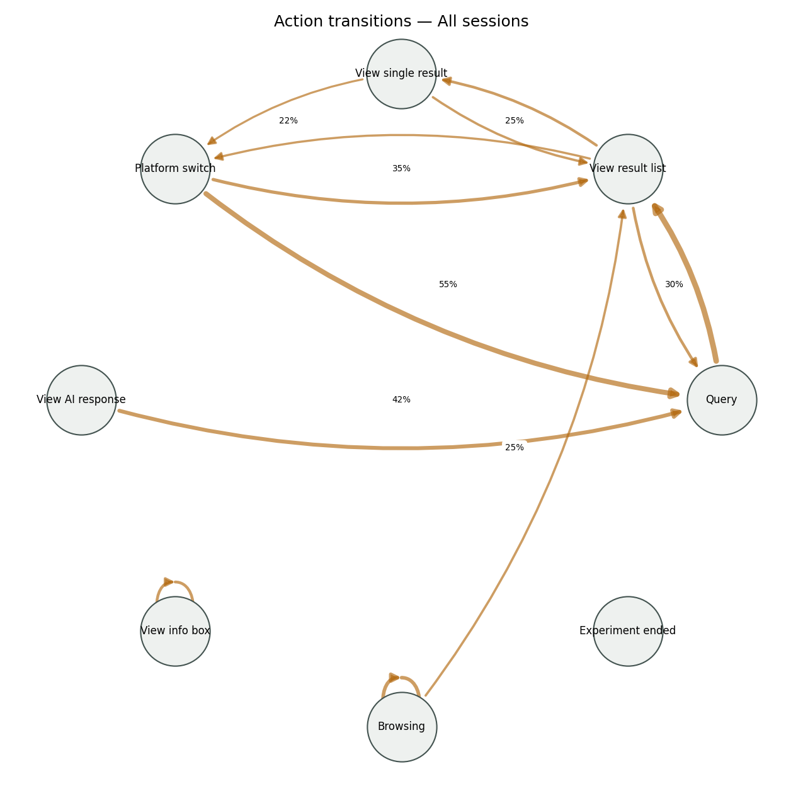

Top overall bigrams (`results/rq2/top_2-grams_overall.csv`): `Query → View
result list` (196), `Platform switch → Query` (131), `View result list →
Query` (109), `View result list → View single result` (105).

### 3.2 What "typical" looks like per game

The clearest signal is in the *exit* probabilities — how likely each action
is to be followed by `Experiment ended`:

| From → Experiment ended | Best Buds vs Bad Guys | Townscaper |
|---|---:|---:|
| View info box | 4.9% | **36.4%** |
| View single result | 4.2% | **19.4%** |
| View AI response | 6.3% | 11.1% |
| (all other actions) | ≤3.6% | ≤3.4% |

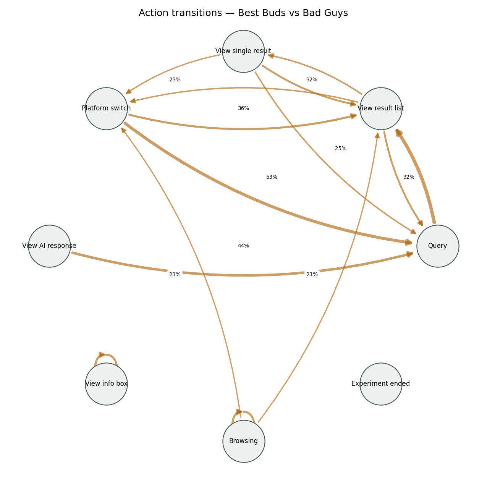

Best Buds has **no strong exit path at all** — every action's probability
of ending the session is small, consistent with 0/21 sessions resolving.

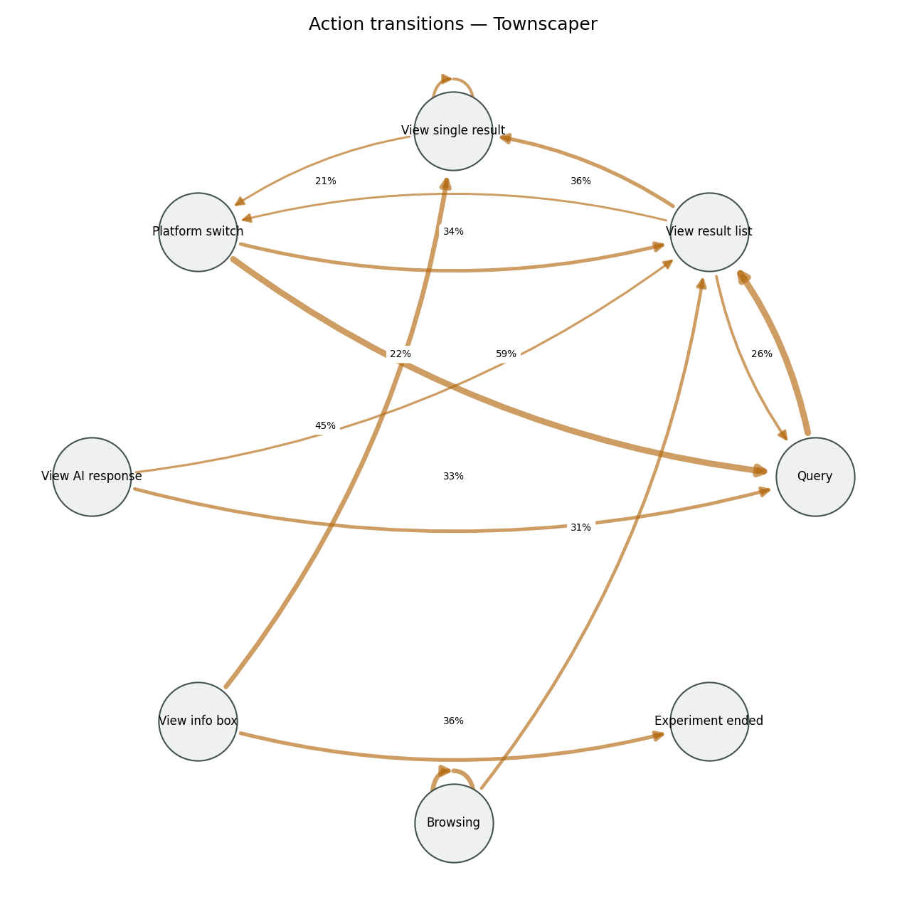

Townscaper has two clear "closing moves": viewing the info box or
re-viewing a single result is, more often than not on the Townscaper side,
how a session actually ends. Townscaper's top-5 trigrams
(`results/rq2/top_3-grams_townscaper.csv`) include `View single result →
View single result → View single result` (12 occurrences) — a
repeat-to-confirm pattern that doesn't appear in Best Buds' top trigrams at
all. This is a first concrete answer to RQ3, developed further there.

Interactive first-6-step flow diagrams (Sankey) and the full bigram/trigram/PrefixSpan
pattern tables are in [`results/rq2/`](../results/rq2/) — not embedded here
since they're interactive Plotly pages.

[↑ Back to top](#top)

## 4. RQ3 — How do search strategies differ between the two games?

This formalizes the resolved-vs-unresolved contrast previewed in §3.2.
Full outputs in [`results/rq3/`](../results/rq3/).

### 4.1 The transition matrices really are different — but only in specific places

A chi-square test compared each action's outgoing-transition distribution
between the two games (`results/rq3/transition_matrix_comparison.csv`);
Jensen–Shannon divergence gives a comparable effect-size that doesn't
depend on chi-square's sparse-cell assumptions:

| From | χ² | p | JS divergence |
|---|---:|---:|---:|
| View info box | 20.27 | **0.003** | 0.669 |
| View single result | 24.86 | **<0.001** | 0.346 |
| View AI response | 10.21 | 0.116 | 0.372 |
| Browsing | 7.72 | 0.172 | 0.432 |
| View result list | 7.18 | 0.411 | 0.163 |
| Query | 6.38 | 0.496 | 0.132 |
| Platform switch | 3.54 | 0.617 | 0.145 |

Only two states show a statistically robust difference (both survive a
Bonferroni correction across the 7 tests, α=0.0071): **`View info box`**
and **`View single result`** — exactly the two "closing move" states
identified in §3.2. The core loop (`Query`, `View result list`, `Platform
switch`) behaves statistically the same in both games; the games diverge
specifically in what happens once a participant is looking closely at a
result. Pooling the full matrices gives a global JS divergence of 0.27
(0=identical, 1=disjoint) — a real but partial difference, consistent with
a shared backbone plus a different ending.

### 4.2 Session-level features (paired by participant, n=21)

| Feature | Median (Best Buds) | Median (Townscaper) | Wilcoxon p |
|---|---:|---:|---:|
| Session length | 47 | 13 | **0.0003** |
| Action entropy | 2.16 bits | 2.08 bits | 0.050 |
| Query rate | 0.28 | 0.25 | 0.243 |
| Platform-switch rate | 0.19 | 0.20 | 0.338 |

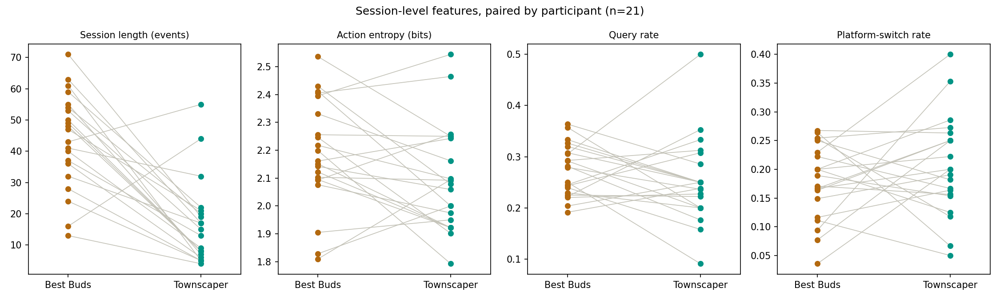

Length aside (expected — Best Buds runs the full clock, see §2.3), **query
rate and platform-switch rate don't differ between games**: participants
query and switch platforms at similar rates regardless of whether they're
going to succeed. Entropy trends slightly *higher* for Best Buds, not
lower — the opposite of a naive "unresolved search looks more repetitive"
prediction. That's addressed directly in §4.3.

### 4.3 Inside an unresolved search: does Best Buds plateau or keep exploring?

Splitting each Best Buds session at its midpoint and comparing halves:

- **Entropy rises**, not falls, from the first half (2.06 bits) to the
  second half (2.23 bits), Wilcoxon p=0.042 — participants broaden their
  action mix as the session goes on, rather than narrowing into a tight
  loop.
- But only **36% of second-half bigrams are genuinely new** (not seen in
  the first half) — most of what happens later in the session is a repeat
  of bigrams already tried earlier.

Together these paint a specific picture of what a failed search looks
like here: not a participant stuck repeating one or two actions (that
would show *falling* entropy), and not a systematic widening search either
(that would show a *higher* novel-bigram rate). It's closer to **cycling
through an already-explored repertoire while occasionally trying one more
action type** (e.g. finally opening `View info box` or `Browsing` late in
the session) — broadening the action *mix* slightly without making
much headway on genuinely new *combinations*.

[↑ Back to top](#top)

## 5. RQ4 — Are there clusters of users with similar search processes?

Run separately per game (21 sessions each — pooling both games would
mostly just rediscover the RQ3 resolved/unresolved split rather than
within-game strategy variation). Two independent views per game, plus a
leave-one-out (LOO) stability check and a cross-game consistency check.
Full outputs in [`results/rq4/`](../results/rq4/).

**Method:** (1) *sequence-distance* — normalized Levenshtein edit distance
between raw action sequences, agglomerative clustering, k chosen by
silhouette score; (2) *feature-based* — per-session action-mix vector (7
action proportions + entropy), standardized, k-means, k chosen the same
way. Stability: recluster with each session left out in turn and compare
(Adjusted Rand Index, ARI) against the full clustering restricted to the
remaining sessions — low mean ARI would mean the clusters aren't robust to
exactly which 21 people happened to be sampled.

### 5.1 Best Buds vs Bad Guys — two clusters, cleanly separated by AI/info-box reliance

| Cluster | n | Query | View result list | View AI response | View info box | Entropy | Length |
|---|---:|---:|---:|---:|---:|---:|---:|
| 0 — "list-browsers" | 14 | 26% | **35%** | 3% | 1% | 2.12 | 50 |
| 1 — "AI-assisted" | 7 | 29% | 14% | **20%** | **12%** | 2.33 | 32 |

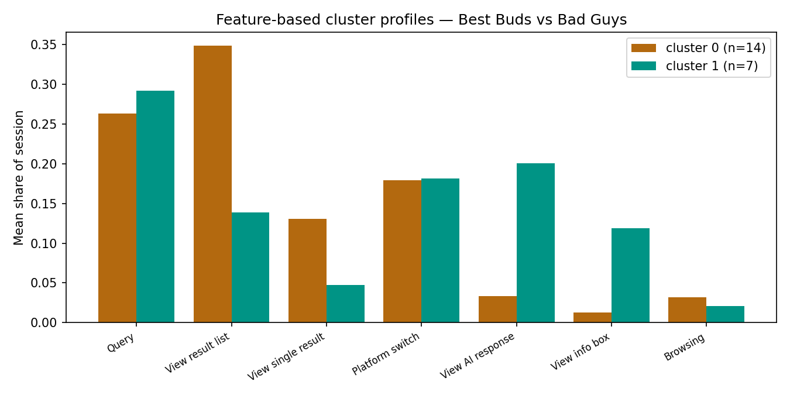

Feature-based k=2, silhouette 0.28, **LOO mean ARI = 1.00** (perfectly
stable across all 21 leave-one-out folds). One subgroup (n=14) searches by
repeatedly opening result lists; the other (n=7) leans heavily on
`View AI response` and `View info box` instead, with shorter, higher-entropy
sessions. The sequence-distance view (LOO ARI also 1.00) finds a different
split — 2 extreme-length outliers vs. everyone else — so the two views
agree only weakly with each other (ARI 0.20): they're picking up genuinely
different structure (raw session length/shape vs. action-type mix), not
duplicating the same signal.

### 5.2 Townscaper — a small "AI-quick" subgroup stands out

| Cluster | n | Query | View AI response | Browsing | Length |
|---|---:|---:|---:|---:|---:|
| 0 — typical | 17 | 24% | 2% | 4% | 18 |
| 1 — "AI-quick" | 4 | 31% | **28%** | 0% | **7** |

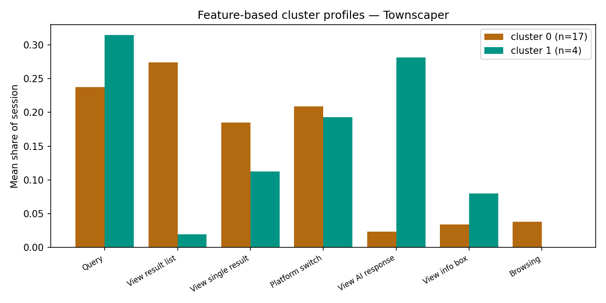

Feature-based k=2, LOO mean ARI = 0.84 (moderate-to-good — less stable
than Best Buds, expected given Townscaper sessions are much shorter and
more homogeneous, so there's less signal per session). The sequence-distance
view again finds a different 2-way split here (LOO ARI 0.67), and the two
views barely agree (ARI ≈ 0.03). With the "AI-quick" cluster this small
(n=4), treat it as a descriptive lead, not a confirmed subtype. *(Updated
2026-08-19: after a data correction — see §1 — the optimal k for this
split shifted from 3 to 2. A small "wanderers" outlier pair, previously
its own cluster, no longer separates from the majority group at the
silhouette-optimal k; the "AI-quick" cluster is unchanged. Small-N
clustering being this sensitive to a handful of events is itself
informative — it's why §5's clusters were treated as descriptive leads
throughout, not confirmed subtypes.)*

### 5.3 Cross-game consistency: is this a personal style, or purely task-driven?

Comparing each participant's feature-based cluster label in Best Buds
against their label in Townscaper gives **ARI = 0.47** — a real, moderate
relationship, not zero. Concretely: **all 4 members of Townscaper's
"AI-quick" cluster come from Best Buds' "AI-assisted" cluster** (the n=7
group). So the AI/info-box-reliance dimension found in Best Buds isn't
just noise from a long, unresolved task — a subset of the same people show
the same tendency on Townscaper too, where it manifests as unusually fast,
AI-driven resolution. That's suggestive of a genuine individual
search-style difference layered on top of the game-level (RQ3) effect,
though with only 4–7 people involved, this wants a larger sample before
leaning on it too hard. **§7's platform data (RQ7) makes this concrete**:
this cluster's platform switches actually go to AI assistants, and its
queries are markedly longer — not just an artifact of the action-type
proportions used to build the cluster.

[↑ Back to top](#top)

## 6. RQ5 — Does the annotator influence how a search process is coded?

Two parts. **6.1–6.2 are the primary analysis**: the dedicated agreement
sample (`data/agreement/`) — participant ID13, both games, independently
segmented and labeled by six annotators (annotator1–6; annotator5/6 were
added 2026-09-07, expanded from an original four). `annotator4` is the
annotator who coded ID13 in the main dataset, so it doubles as the
reference sequence. This is the only place multiple annotators coded the
*same* recording, so it's the only place an annotator effect is actually
identifiable. **6.3 is a secondary, confounded check** on the 21
individually-annotated participants, added at the researcher's request —
read its caveats before its numbers. Full outputs in
[`results/rq5/`](../results/rq5/) and [`results/rq5b/`](../results/rq5b/).

**Method note — this couldn't be a plain Cohen's kappa.** The six
annotators' files have different row counts — they independently
*segmented* the recording, not just labeled a shared fixed set of events.
So there's no common "item" to rate until the sequences are aligned.
Method: (1) align annotators 1–3, 5, 6 against the annotator4 reference
via minimum-edit-distance sequence alignment; (2) Krippendorff's alpha
(nominal) on the aligned matrix; (3) pairwise alignment-free sequence
similarity (all 15 pairs) as a complementary view; (4) a pooled confusion
table and per-action count comparison.

### 6.1 Labels agree almost perfectly — when annotators agree an event happened at all

| Game | Krippendorff's α (aligned) |
|---|---:|
| Best Buds vs Bad Guys | 0.97 |
| Townscaper | 0.91 |

Taken alone, these look excellent. But α only scores positions where
annotators aligned to the *same* event — it treats an unmatched
("missing") position as simply absent data, not disagreement. That
hides the real story:

| Annotator | Best Buds coverage | Best Buds agreement-when-covered | Townscaper coverage | Townscaper agreement-when-covered |
|---|---:|---:|---:|---:|
| annotator1 | 94% | 94% | 78% | 94% |
| annotator2 | **77%** | 100% | **42%** | 100% |
| annotator3 | 100% | 100% | 82% | 92% |
| annotator5 | 82% | 100% | 56% | 88% |
| annotator6 | 82% | 100% | 56% | 96% |

*Coverage* = share of the reference annotator's (annotator4's) events that
this annotator also identified at all. **When annotators do align on the
same event, they almost always label it identically** (88–100%) — the
labeling scheme itself isn't the problem. The problem is *segmentation*,
and it's not just one outlier: `annotator2` is the extreme case (42%
Townscaper coverage), but `annotator5`/`annotator6` sit in a moderate
band below `annotator1`/`annotator3` (56% vs. 78–82%) — coding
granularity looks more like a spectrum than a single bad apple, worse
for the longer, more repetitive Townscaper sessions across the board.
`annotator5` and `annotator6` are, however, nearly identical *to each
other* (similarity 1.00 on Best Buds, 0.81 on Townscaper).

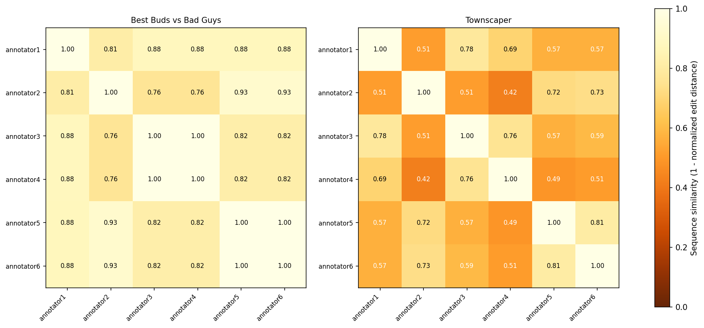

### 6.2 Practical implication for the main dataset

In the main 21-participant dataset, annotator2 coded ID6–ID10 (§2). If
annotator2's coarser segmentation style shown above generalizes, those 5
participants' session lengths/action counts in RQ1–RQ4 are likely
*undercounts* relative to how the other annotators would have coded the
same recordings — a real, if modest (5/21 participants), source of noise
layered on top of the genuine between-participant variation those
analyses report. §6.3 checks this directly.

### 6.3 Secondary check on the main dataset — confounded, read the caveat first

Every result in this subsection compares *blocks of participants*, not
annotators in isolation: `annotator1`→ID1–5, `annotator2`→ID6–10,
`annotator4`→ID11–15, `annotator3`→ID16–21. Annotator and "which five/six
participants" are the same partition of the data, so anything found here
could be genuine annotator style, or it could just be that those
particular people behave differently — this dataset alone cannot tell
the two apart. Treat everything below as descriptive, cross-checked
against 6.1's unconfounded finding where possible, not as independent
proof of an annotator effect. Every feature is computed per (participant,
game) first and normalized within that session *before* averaging within
an annotator's block, so one long session can't dominate its annotator's
average.

**The corroboration is real but partial.** Comparing annotator2's
profile against the other three's average:

| Action | annotator2 | other annotators | difference |
|---|---:|---:|---:|
| View result list | 22.1% | 26.1% | **−4.0pp** |
| View single result | 10.5% | 15.0% | **−4.5pp** |
| Platform switch | 17.0% | 20.0% | **−3.0pp** |
| Browsing | 2.4% | 3.0% | −0.6pp |
| View AI response | 12.2% | 6.9% | **+5.3pp** |
| View info box | 8.0% | 3.3% | **+4.7pp** |

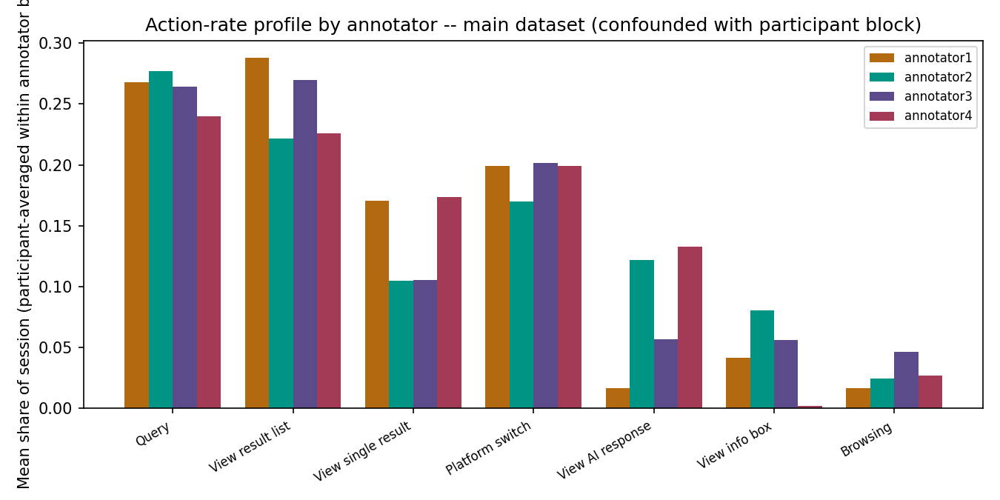

The three actions RQ5's agreement sample flagged as undercounted
(`View result list`, `Platform switch`, and — closely related —
`View single result`) are all lower for annotator2's block here too,
consistent with the coarser-segmentation finding. But `View AI response`
and `View info box` are *higher*, not lower — the opposite of a simple
"undercounts everything" story. The likely mechanism: if annotator2
tends to merge or miss quick, routine actions (successive result-list
glances) while reliably catching the more salient, memorable ones
(opening an AI response or info panel), the *proportion* going to those
salient actions would mechanically inflate even without any real
behavioral difference — segmentation coarseness distorting a rate
measure, not a labeling error (6.1 already showed labels are correct 88%+
of the time on aligned events). This is a plausible mechanism, not a
demonstrated one.

**Where the confound bites, not just caveats it:** annotator2's block has
the *longest* recorded Townscaper sessions of any annotator (mean 23.2
events vs. 10.6–16.2 for the others) — the opposite direction from what
"coarser segmenter" would predict on its own. Read at face value this
looks like it contradicts 6.1; more likely it just reflects that ID6–10
happened to be a slower-searching group in Townscaper, a genuine
participant effect swamping any segmentation-style signal in this
particular measure. That's the confound doing exactly what the plan
said it would do, not a new finding.

**A random-intercept model** (annotator as the grouping factor, game as
a fixed effect) gives the intraclass correlation — how much of the
between-session variance in each action's rate sits "within annotator
block" — as a summary of how much clustering-by-block exists at all,
independent of cause:

| Feature | ICC (annotator block) |
|---|---:|
| View info box | 0.13 |
| View AI response | 0.13 |
| View single result | 0.06 |
| Query | 0.00 |
| View result list | 0.00 |
| Platform switch | 0.00 |
| Browsing | 0.00 |

(`entropy` is omitted — its model hits a boundary solution and doesn't
converge; treat its near-zero point estimate as "no detectable block
clustering," not a precise number.)
Every ICC is low. Most of the variation in how a session looks is
between individual people, not between annotator blocks — reassuring for
RQ1–RQ4's between-participant comparisons generally. `View AI response`
and `View info box` cluster the most (13% each), which lines up with the
same two actions standing out in the corroboration check above.

**Checked directly, because those two actions matter a lot to RQ4:**
does the RQ4 "AI-assisted"/"AI-quick" cluster just track annotator
block, given the AI-related actions cluster the most here? No —
crosstabbing cluster membership against annotator: Best Buds is close to
uniform (1/2/2/2 "AI-assisted" members across the four annotators);
Townscaper is 0/2/1/1 (annotator1's block has none, small enough to be
chance at n=5). The cluster cuts across annotator blocks rather than
tracking one of them, which is a real (if partial) reassurance that
RQ4's individual-style finding isn't primarily an annotator artifact.

Bigram rates (`results/rq5b/annotator_bigram_profiles.csv`) show the
same broad pattern as the single-action rates — annotator2/annotator4
lean toward `Query → View AI response`-adjacent patterns more than
annotator1/annotator3 — but with only 4 block-level rows to compare,
this is offered as raw data for inspection rather than a further claim.

[↑ Back to top](#top)

## 7. RQ6 — Does game order affect strategy, and do people carry a strategy over? (added at researcher's request)

Motivating idea: participants who played Townscaper first started on a
successful note; participants who played Best Buds first may have built
up frustration before Townscaper. Related: do people open each game the
same way regardless of order, or does the second game's opening echo the
first? Order (11 played Townscaper first, 10 played Best Buds first) is
derived directly from the data — `rank` is one counter spanning both
games per participant. Full outputs in
[`results/rq6/`](../results/rq6/).

### 7.1 No detectable order effect on session-level features

Splitting each game's 21 sessions by whether it was played first or
second and comparing length/entropy/query-rate/platform-switch-rate
(Mann-Whitney U, unpaired): **no feature reaches significance in either
game** (all p ≥ 0.24, most ≥ 0.5). Playing Best Buds after already having
searched once (win or lose) doesn't measurably change how much someone
queries, switches platforms, or how long they take. The frustration/
positive-note hypothesis isn't supported at the level of these
aggregate session features.

### 7.2 But the *opening move* does carry over — and more so after Best Buds

Representing each session's opening as its first 3 actions and comparing
each participant's own first-game-opening to their second-game-opening
against a permutation-test null (10,000 random re-pairings of
participants' openings):

- **Observed mean own-pair distance: 0.254**, vs. **0.330** for randomly
  paired participants — participants are more self-consistent than chance,
  one-tailed permutation p = **0.029**. (The null already absorbs the fact
  that almost everyone opens with `Platform switch → Query` — it's built
  from the same real openings, just re-paired — so this is a real
  above-baseline signal, not an artifact of a universal starting move.)
- **Splitting by which game came first is where it gets interesting:**
  participants who played **Best Buds first show near-perfect carryover**
  (median own-pair distance = **0.000** — 7 of 10 have an *exactly
  identical* 3-action opening in both games) vs. **Townscaper-first**
  participants (median **0.333**, only 3 of 11 exact matches).
  Mann-Whitney p = 0.077 — marginal at n=10/11, not a firm result, but a
  clear directional pattern: starting with the harder, unresolved game
  seems to lock in a strategy that gets repeated verbatim on the second
  game, more than starting with the easy win does.

This is the opposite framing from the original hypothesis but a coherent
story: it's not that Best-Buds-first participants search *differently* in
Townscaper (§7.1 found no feature differences) — it's that they open
Townscaper the same way they opened Best Buds, more rigidly than
Townscaper-first participants replicate their Townscaper opening in Best
Buds. Ties back to RQ4's cross-game consistency finding (§5.3, ARI=0.47):
this gives that consistency a direction and a plausible driver (which
game came first), though both findings share the same small-n caveat.

### 7.3 Order doesn't predict RQ4 cluster membership

Crosstabbing play position against each game's RQ4 feature-cluster label
(both now a clean 2×2, since RQ4's Townscaper split simplified to 2
clusters — see §5.2): **no relationship in either game.** Best Buds:
Fisher exact p=1.0. Townscaper: 3 of the 4 "AI-quick" cluster members
played Townscaper *first* (vs. 1 second), Fisher exact p=0.59 — a
numerical lean opposite to what §7.2 might predict, but not close to
significant with n=4 in that cluster.

### 7.4 RQ6.4 — Does order change *how* people search within each game?

§7.1 found no order effect on four *summary* features. This applies RQ3's
full toolkit — action mix, transition matrices, closing moves,
first/second-half dynamics — split by order instead of by game, to ask
the sharper version of the researcher's question directly: is Best Buds
searched differently after a Townscaper win, and is Townscaper searched
differently after Best Buds frustration? Full outputs in
[`results/rq6_4/`](../results/rq6_4/).

**Aggregate action mix: still no order effect in either game**
(Best Buds χ²=9.51, p=0.15; Townscaper χ²=4.13, p=0.66) — confirms §7.1
at the level of the full action-count table, not just 4 derived features.

**But two specific, well-supported effects show up underneath that:**

- **Townscaper: after viewing a single result, order changes what happens
  next — robustly** (χ²=22.56, p=**0.001**, survives Bonferroni across the
  7 from-states, α=0.0071; *strengthens* to p=0.0004 after stripping the
  opening 3 actions, so it isn't an artifact of the carried-over opening
  move). Concretely:

  | From `View single result` → | Played first | Played second (after Best Buds) |
  |---|---:|---:|
  | Experiment ended | 25% | 15% |
  | Platform switch | 29% | 15% |
  | Browsing | 14% | 0% |
  | **View single result (self-loop)** | 4% | **47%** |

  Townscaper-first participants who check a single result branch out —
  switch platform, browse, or confidently end the session. Participants
  who reach Townscaper *after* Best Buds instead re-check the same result
  again and again (a 47% self-loop, vs. 4%) rather than branching out or
  concluding. Reads as hesitancy/double-checking carried over from an
  experience where the obvious-looking result kept being wrong.

- **Best Buds: the "entropy rises through the session" finding from §4.3
  is really a played-second effect.** Splitting that half-split analysis
  further by order:

  | Best Buds order | First-half entropy | Second-half entropy | Wilcoxon p | Novel-bigram rate (2nd half) |
  |---|---:|---:|---:|---:|
  | Played first (n=10) | 2.16 | 2.25 | 0.625 | 28% |
  | Played second, after Townscaper win (n=11) | 1.96 | 2.22 | **0.032** | **44%** |

  When Best Buds is a participant's first task, there's no significant
  broadening and few genuinely new bigrams late in the session — closer
  to settling into repetition. When Best Buds comes *after* an already-won
  Townscaper, the entropy rise is significant and nearly half of late
  bigrams are genuinely new combinations — participants explore more
  persistently when they hit a wall, if they've already banked a win.
  That's the "positive note" hypothesis showing up — not in whether Best
  Buds gets solved (nobody solves it), but in *how hard and how broadly*
  people keep trying.

**Caveat carried over from the plan:** both effects are per-cell
comparisons of ~10 vs. ~11 sessions, on top of an already-small study —
treat as suggestive rather than confirmatory, though the Townscaper
result clears the same Bonferroni bar used for the game-level comparison
in RQ3 and gets *stronger*, not weaker, once the opening-carryover
confound is controlled for.

**One more data point, not a finding:** the one Townscaper session that
looks unresolved (55 events, far beyond the next-longest at 44 — inferred
from session length, not a ground-truth outcome label) belongs to `ID9`,
who played Best Buds first. Consistent with, though certainly not proof
of, the frustration-carryover story — n=1.

[↑ Back to top](#top)

## 8. RQ7 — Enriching the analyses with destination and query-length data

Two new columns (added by the researcher, 2026-08-19): `action_details_clean`
(destination platform for `Platform switch`; source site for
`View single result`) and `action_details_num_tokens` (length of the
withheld free-text field — most meaningful for `Query`). Full outputs in
[`results/rq7/`](../results/rq7/); method and the `#REF!` data-quality fix
in [`docs/planning_and_background.md`](../docs/planning_and_background.md) §4.7.

### 8.1 Platform-switch destinations ground-truth the RQ4 cluster names

Categorizing the 23 observed destinations (search engine / AI assistant /
storefront / community / game database — see
[`results/rq7/platform_category_by_game.csv`](../results/rq7/platform_category_by_game.csv)):
search engines dominate both games (~78% of switches), with AI assistants
slightly more common in Best Buds (10%) than Townscaper (6%), and
community sites (mostly Reddit, including the aptly-named
r/tipofmyjoystick) more common in Townscaper (6%) than Best Buds (2%).

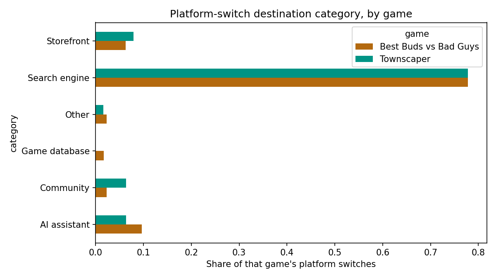

The sharper result is **by RQ4 cluster**:

| Game | Cluster | AI-assistant share of platform switches |
|---|---|---:|
| Best Buds | 0 — "list-browsers" (n=14) | 2% |
| Best Buds | 1 — "AI-assisted" (n=7) | **33%** |
| Townscaper | 0 — typical (n=17) | 2% |
| Townscaper | 1 — "AI-quick" (n=4) | **60%** |

This wasn't built into the clustering (RQ4 used only `View AI response`/
`View info box` *action* proportions) — it's an independent confirmation
that the "AI-assisted"/"AI-quick" cluster names describe something real:
those participants' platform switches concretely go to ChatGPT, Google AI
Mode, and Meta.AI, not just to a same-named action category.

### 8.2 The AI-cluster writes longer queries — direction holds, but underpowered

Per-participant *median* query length (tokens), aggregated by RQ4 cluster
(median rather than mean, and one query per participant rather than one
row per query, to avoid pseudo-replication — an instance-level test
looked dramatically "significant" purely from treating each of one
person's many queries as an independent observation):

| Game | Cluster | Median query length (tokens) | Mann-Whitney p |
|---|---|---:|---:|
| Best Buds | list-browsers | 5.25 | |
| Best Buds | AI-assisted | **13.0** | 0.13 |
| Townscaper | typical | 4.0 | |
| Townscaper | AI-quick | **14.5** | 0.13 |

A real, substantial, consistently-directional effect (2.5–3.6× longer
median queries) — makes mechanistic sense, since AI assistants invite
full-sentence prompts where search engines invite keywords — but at
proper participant-level n (7 vs. 14; 4 vs. 17) it doesn't clear
conventional significance. One participant (`ID15`) is a striking
illustration: in the AI-assisted/AI-quick cluster in *both* games, with
individual queries running to 239 and 189 tokens — paragraph-length
prompts, not search terms. The cluster-level effect holds even excluding
that one participant (Best Buds AI-cluster median 9.75 vs. 5.25 tokens
without them), so it isn't purely an `ID15` artifact.

Query length does **not** change across a Best Buds session (first-half
vs. second-half mean tokens, Wilcoxon p=0.43) — RQ3 §4.3's "entropy
rises through the session" finding is about broadening *which* actions
happen, not writing longer queries as the session wears on.

### 8.3 Townscaper's played-second self-loops are mostly re-checking the *same* source

The strongest RQ6.4 finding was `View single result`'s 47% self-loop
rate in Townscaper when played after Best Buds (vs. 4% when played
first, §7.4). The new source data specifies what that self-loop actually
is:

| Game | Self-loops | Same source repeated |
|---|---:|---:|
| Best Buds | 10 | 30% |
| Townscaper | 17 | **65%** |

Nearly two-thirds of Townscaper `View single result → View single
result` transitions revisit the *same* site rather than checking a
different one. (Almost all of these 17 self-loops come from
played-second sessions — only 1 occurred in a played-first session,
too sparse to compare rates by order directly — but that near-total
concentration in played-second sessions is itself consistent with §7.4's
story.) This sharpens "hesitancy/double-checking" from §7.4 into
something more literal: re-opening the same Steam page or Reddit thread
repeatedly, not sampling a wider set of sources before deciding.

[↑ Back to top](#top)

## 9. RQ8 — Which platforms are involved in finding Townscaper, and in what order?

Follow-up to RQ7, requested by the researcher: not just *where* platform
switches go pooled across a session, but which platforms are actually
involved in finding Townscaper specifically, which one is typically
showing when the game gets identified, and whether there's a consistent
*order*. Best Buds is included throughout as a cheap comparison column.
Full outputs in [`results/rq8/`](../results/rq8/); code:
[`analysis/rq8_platform_sequence.py`](../analysis/rq8_platform_sequence.py).

### 9.1 Search engines are the hub; everything else is a spoke

Categorizing every `Platform switch` destination in Townscaper sessions
(n=63): search engines account for 78% (Google/DuckDuckGo variants),
storefronts (Steam) 8%, AI assistants and community sites (Reddit) 6%
each. Best Buds looks almost identical in proportion (78% search engine)
but leans harder on AI assistants (10% vs. Townscaper's 6%) — consistent
with RQ7 §8.1's cluster-level finding, just visible here in the raw
game-level totals too.

The **order** is the more interesting part:

| From \ To | Search engine | AI assistant | Storefront | Community |
|---|---:|---:|---:|---:|
| Search engine | 26 | 1 | 5 | 3 |
| Storefront | 3 | 1 | 0 | 0 |
| Community | 2 | 0 | 0 | 0 |

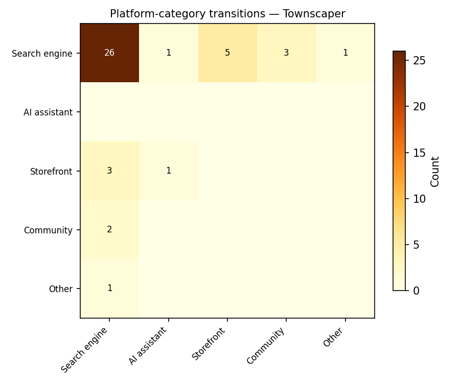

Storefronts and community sites only ever connect *back to* a search
engine — never to each other directly, and search engine is by far the
most common state to switch *into* from anywhere. That's a hub-and-spoke
pattern: search engines are the hub participants keep returning to;
Steam/Reddit/etc. are spokes visited and left, not a chain (e.g. never
Steam → Reddit directly).

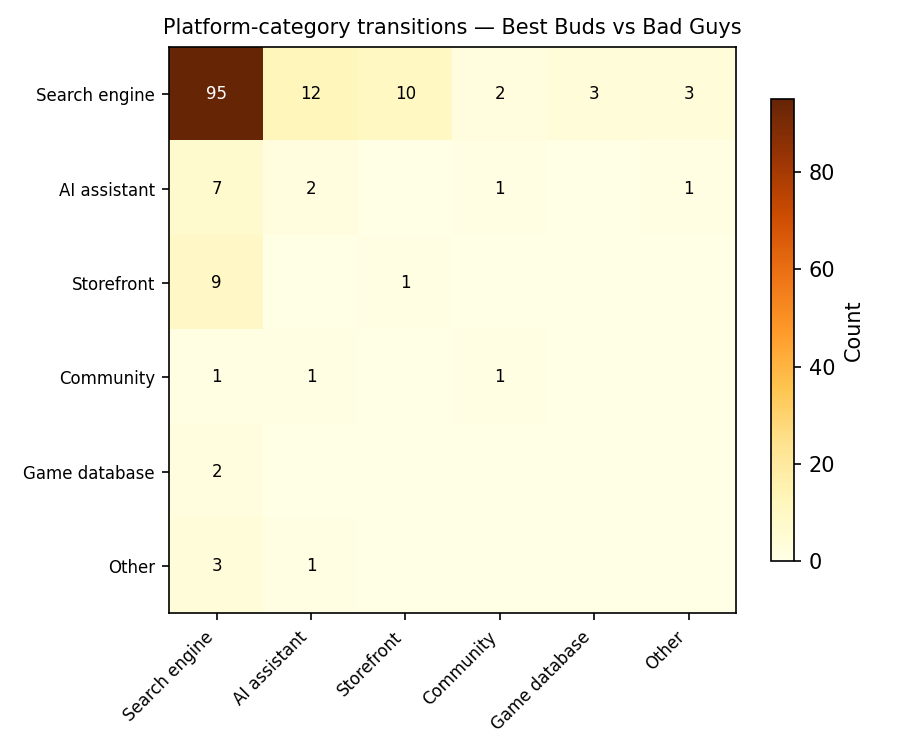

Best Buds shows the identical structure, just with more AI-assistant
traffic through the hub — the *shape* of platform navigation, like the
action-level backbone in RQ2, doesn't depend on which game or whether it
gets solved.

This also shows up as *where sessions open and close*: 85% of Townscaper
sessions make their first platform switch to a search engine, and 80%
end on the same category they started on (n=20 sessions with ≥1 switch).
Best Buds opens on a search engine even more often (95%) but returns to
the same category only 62% of the time, and is more likely to end on an
AI assistant (29% vs. Townscaper's 20%) — a session that keeps
wandering, matching RQ3/RQ4's picture of Best Buds as the less settled,
more exploratory task.

### 9.2 Steam is where people *look*; the "aha" moment is scattered elsewhere

Steam is the single most-visited source when participants open a single
result in Townscaper (23 of the ~89 `View single result` instances — by
far the top individual site, ahead of Reddit at 5). But looking
specifically at what's on screen right before the session actually ends
(closing action = `View single result`, n=12 of 21 sessions — the
plurality closing move, ahead of `View info box` at 4, `View result
list` at 3, `View AI response` at 2): **Steam accounts for only 2 of
those 12.** The rest are one-off — a gaming blog
(`videospielgeschichten.de`, `gamestar.de`, `Ratgeber-videospiele.dk`),
a community/wiki-style page (`The Cozy Gaming Nook`, `Gamers-place`), a
video (`TikTok video`, `Youtube`), a Google Image result, or the game's
own site directly.

So Steam functions as a *browsing* hub — a place to check candidates —
much more than a *confirming* one. The moment someone actually recognizes
the game tends to come from a smaller, more idiosyncratic source, not
the platform they spent the most time on. (One caveat carried over from
earlier sections: outcome isn't a ground-truth label here — `ID9`'s
Townscaper session, the one inferred non-solver from RQ3/RQ6.4, closes
on `View result list`, not `View single result`, so it's correctly
excluded from this "closing move" tally rather than contaminating it.)

[↑ Back to top](#top)

## 10. RQ10 — Does a finer platform breakdown surface image-search reliance?

Researcher-provided `data/platform_map.json` splits RQ7/RQ8's coarse
"Platform switch" destination categories (search engine / AI assistant /
storefront / community) into finer ones — Web search, Image search,
Conversational search, Game search, and several rarer categories —
motivated by an impression that participants relied heavily on image
search specifically, which the coarser buckets couldn't distinguish from
ordinary web search. Applied via a new `context` column
(`analysis/data.py`) that reconstructs which platform/website each action
happens on by forward-filling the most recent `Platform switch`
destination within a session. Full methodology in
[`docs/planning_and_background.md`](../docs/planning_and_background.md)
§4.9; code in
[`analysis/rq10_finer_platform_categories.py`](../analysis/rq10_finer_platform_categories.py);
outputs in [`results/rq10/`](../results/rq10/).

### 10.1 Image search is the second most-used category overall

| Category | Count | Share |
|---|---:|---:|
| Web search | 502 | 39% |
| **Image search** | **312** | **24%** |
| Conversational search | 128 | 10% |
| Game search | 117 | 9% |
| (6 rarer categories combined) | 24 | 2% |

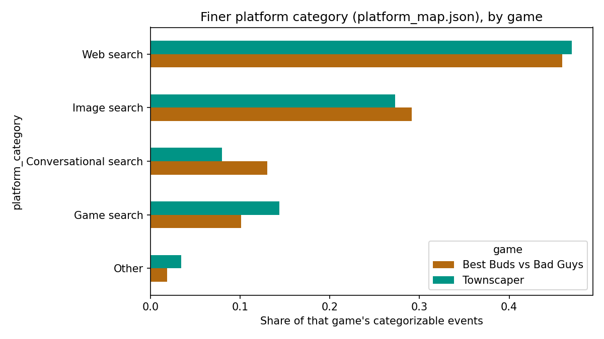

The motivating impression holds up: image search is a clear second to
web search, well ahead of conversational (AI-assistant) search, in both
games — 240/823 events (29%) in Best Buds vs Bad Guys, 72/263 (27%) in
Townscaper.

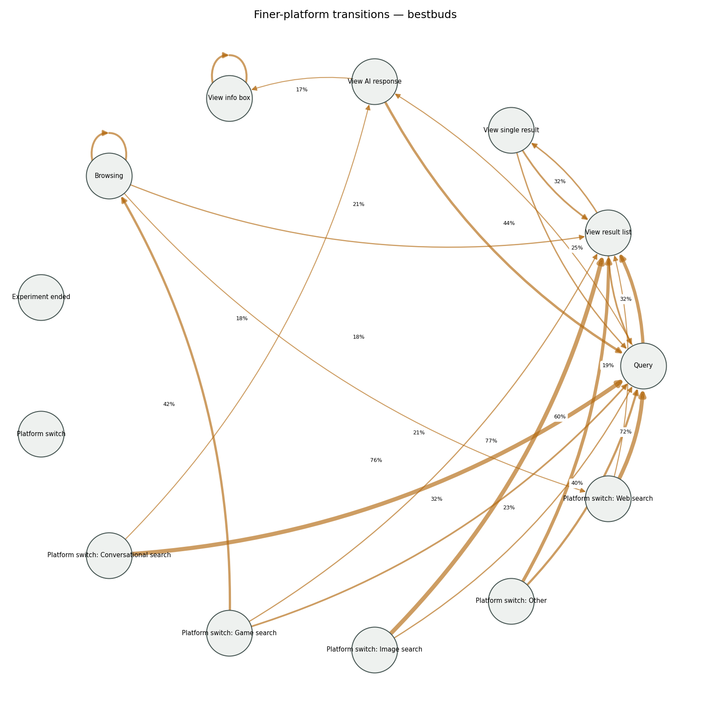

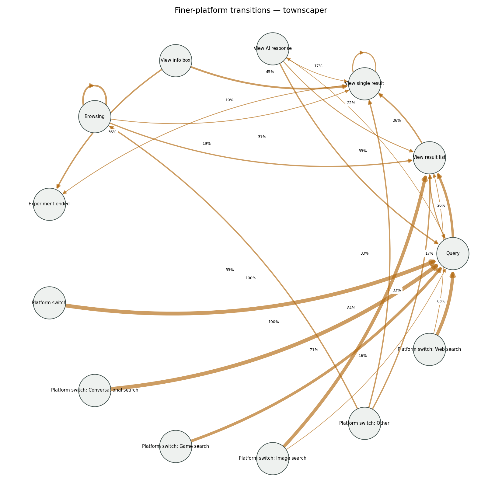

Both transition graphs use the *same* fixed 13-state layout (7 base
actions plus 6 platform-switch categories that actually occur in the
data), so a state's position is identical across the two games —
comparable at a glance rather than needing to hunt for which circle moved.
`Platform switch: Image search` behaves like a normal search hub in
both: mostly followed by `View result list` (77–84%), occasionally by
another `Query`.

### 10.2 Image-search reliance and AI-assistant reliance are separate styles

Cross-checked against RQ4's clusters (§5), since it turned out to be a
striking result: in Townscaper, the 4-member "AI-quick" feature-cluster
(`ID6`, `ID7`, `ID15`, `ID18` — high `View AI response` share) uses image
search **0% of the time, unanimously**, while the 16-member majority
cluster averages **35.2%** (individual range 0–81%). Best Buds shows the
same direction, more weakly: 15.4% vs. 29.7%. Read next to RQ4's original
AI-vs-majority split, this suggests image-search reliance and
AI-assistant reliance are two distinct, largely mutually exclusive search
styles — leaning on an assistant to shortcut the search, or leaning on
reverse image search to visually match the game — rather than something
people mix.

**Two data-quality flags**, normalized in code rather than fixed at the
source: `data/platform_map.json` has a `"Meta.AI": "Conservational
search"` typo (should be "Conversational"), and the raw data contains
both `"Moby Games"` and `"MobyGames"` as distinct `Platform switch`
destinations, only the latter of which is in the map — 4 events fall
through to "Uncategorized" as a result.

[↑ Back to top](#top)

## 11. RQ11 — Search tactics as recurring action sub-sequences

Researcher-proposed, inspired by Wildemuth, Oh & Marchionini (2010), who
derived named search "tactics" from Maximal Repeating Patterns (MRP) in
coded action sequences, then manually discarded any MRP occurrence
subsumed by (contained within) a longer one before grouping the
survivors by hand. Two automated, complementary takes on that idea, run
per game on the coded action sequences (`Experiment ended` excluded — a
fixed bookkeeping marker, not a search move). Full methodology in
[`docs/planning_and_background.md`](../docs/planning_and_background.md)
§4.8; code in
[`analysis/rq11_maximal_repeats.py`](../analysis/rq11_maximal_repeats.py);
outputs in [`results/rq11/`](../results/rq11/).

### 11.1 The flat view: supermaximal repeats

A **supermaximal repeat** is a maximal repeated sub-sequence with no
single occurrence contained inside an occurrence of another, longer
repeat — found via a suffix array and LCP array, and verified against a
brute-force reference implementation. That occurrence-level containment
check is the automated equivalent of Wildemuth's manual dedup step.

**How to read the figure below.** Each strip is one recurring tactic;
each colored box is one step, left to right, colored by action (same
palette as RQ2). The number after each strip is how many *distinct
participants* used that exact tactic at least once — not the raw count
of occurrences, which can overstate things if one participant repeats a
tactic within their own session (see the callout below the figure for a
concrete case). A tactic is only reported here once it clears length ≥3
(bigrams are already covered by RQ2's n-gram tables) **and** is used by
≥3 distinct participants — a much lower bar than Wildemuth's count-≥5 on
141 sequences, since this dataset has only 13–21 sequences per game.
Every tactic that clears the bar in this data happens to be used by
*exactly* 3 participants — nothing reaches 4 or more — so there's no
frequency variation left to rank by; rows are then ordered by length,
longest first, which is why the strips read top-to-bottom as "longest
first" rather than "most common first."

**Best Buds vs Bad Guys** (unsolved, 0/21) has 143 supermaximal repeats
overall, of which **9** clear the bar (longest: 7 steps); **Townscaper**
(solved, 20/21) has 48 overall, but **none** reach 3 participants — its
best candidate, a 4-step check-and-move-on pattern, is used by only 2.

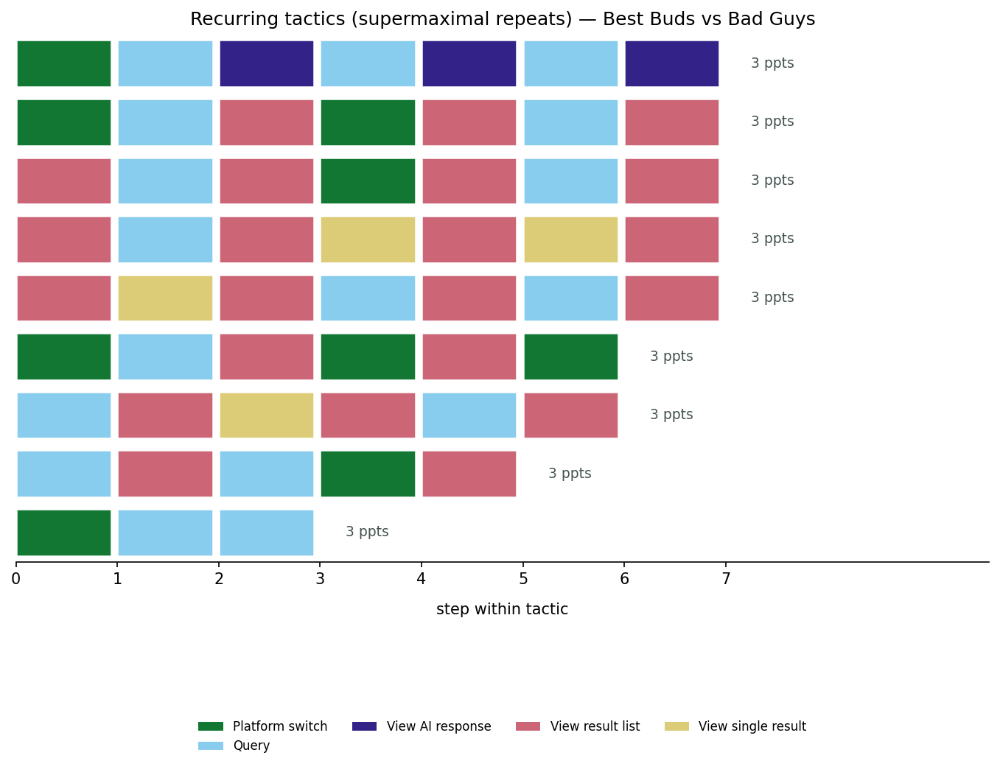

Since the strips alone don't make it obvious which short steps recur
*across* several of the 9 tactics, here's that directly: for each 2-step
sub-pattern, in how many of the 9 tactics it appears at least once
(counted once per tactic, not per raw occurrence):

| Building block | In how many of the 9 tactics |
|---|---:|
| `Query → View result list` | 7 |
| `View result list → Query` | 6 |
| `Platform switch → Query` | 4 |
| `Platform switch → View result list` | 4 |
| `View result list → Platform switch` | 3 |
| `View single result → View result list` | 3 |
| `View result list → View single result` | 3 |

`Query ↔ View result list` — the core loop from RQ2 §3.1 — is the
backbone of nearly every tactic here; what makes a *tactic* rather than
just that loop is which detour (`Platform switch` or `View single
result`) gets threaded through it, and in what order.

Townscaper produces no report-worthy flat tactics at all — a second,
independent confirmation (after §11.2 below) that its sessions don't
develop recurring multi-step habits the way Best Buds' do.

### 11.2 The hierarchical view: a RE-PAIR grammar

The flat list above can't show a repeated pattern that's itself built
out of a smaller repeated pattern, and (as just shown) can undercount
badly if a "repeat" is really one participant looping within their own
session. A **RE-PAIR grammar** (Larsson & Moffat, 1999 — a Sequitur-family
algorithm, chosen over implementing Sequitur directly since its offline
"replace the most frequent adjacent pair, then repeat" loop is much
easier to verify correctly at this scale than Sequitur's cascading
online bookkeeping) fixes both: every rule has exactly two symbols on
its right-hand side, so a rule referencing another rule *is* a tactic
built from smaller tactics, and every node — not just the whole tree —
gets its own participant count.

**How to read the figure below.** Each panel is one RE-PAIR rule,
picked as one of the 5 most composite (longest fully-expanded) rules for
that game, regardless of how many participants use it — this set is
*not* filtered the way §11.1's tactics are, so it can and does surface
rarer, longer structures. Colored circles are terminal actions (leaf of
the tree); grey circles are sub-rules, each labeled with how many
distinct participants have that exact sub-pattern somewhere in their
session. The panel title gives the *whole* rule's participant count and
length; every other grey circle in the tree is a smaller "sub-tactic" in
its own right, with its own, usually much higher, participant count.

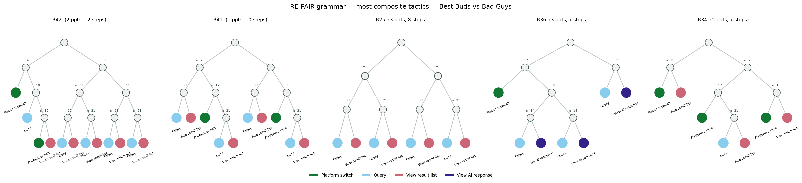

Reading `R42` (leftmost, 2 participants, 12 steps): its right child
decomposes down through a sub-rule that is `Query → View result list`
repeated twice — that specific 4-step doubled loop alone is used by
**11** participants, over half the game, even though the full 12-step
`R42` it sits inside is used by only 2. That's the point of annotating
every node: `Query → View result list` itself (the smallest sub-rule
visible, bottom of several branches) is used by all **21** participants
— near-universal — so what's actually rare about `R42` isn't any of its
pieces, it's this *specific 12-step chaining* of very common pieces.

The clearest single example of the occurrence-vs-participant gap from
§11.1 shows up in the second panel, `R41` (1 participant, 10 steps):
raw occurrence count is 2, but both occurrences belong to the same
participant, `ID4`, who performed this exact 10-step `Platform
switch`/`Query`/`View result list` sequence twice in a row (27 actions
apart) within their own Best Buds session — a genuine stuck-in-a-loop
moment, not a tactic shared across participants at all.

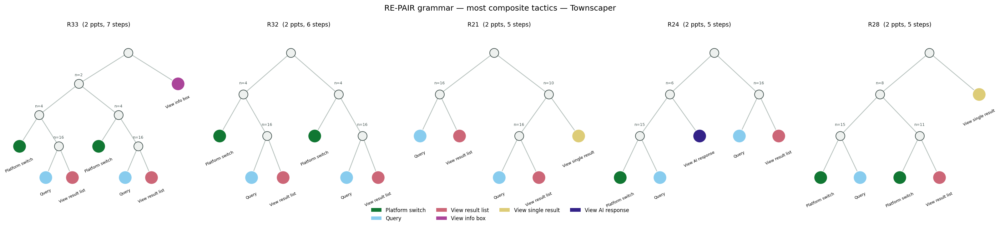

Townscaper's top-5 most composite rules max out at **2 participants
each** — the same ceiling §11.1's flat view found, now confirmed by a
completely independent method starting from the opposite end (longest
structures first, rather than most-shared first). Its trees are also
shallower: mostly one level of nesting (a `Platform switch → Query` or
`Query → View result list` pair, occasionally paired with itself once
more) rather than Best Buds' multi-level chains.

This is a third, independent line pointing at the same conclusion as
RQ3's plateau finding (§4.3) and RQ4's clustering: Best Buds sessions
loop and backtrack in ways Townscaper sessions mostly don't — not just
*more often*, but *more compositionally*, with small, very common loops
getting chained into longer, much rarer ones rather than the session
just ending.

[↑ Back to top](#top)

## 12. Discussion

Seven RQs, read separately, are seven answers. Read together, they
converge on a smaller number of claims about what a post-play game
search actually is. This section pulls those threads together, relates
them to the literature framing in
[`docs/planning_and_background.md`](../docs/planning_and_background.md) §3,
and states plainly what would and wouldn't survive a larger sample.

### 12.1 One search grammar, one game-specific ending

The single clearest result across RQ2, RQ3, and RQ6.4 is that **the
process and the outcome are separable**. RQ2 found a tight, near-universal
loop — `Query → View result list`, splitting into reformulate / drill in
/ switch platform — that RQ3 then showed is *statistically indistinguishable*
between a game nobody solves and a game almost everyone solves (§4.1: 5 of
7 states, p ≥ 0.12). The two games don't diverge in how people search.
They diverge in exactly one place: what happens after `View single
result`, i.e. whether looking closely at a candidate result turns into a
closing move or not (§3.2, §4.1). RQ6.4 then found that even *this*
divergence is order-sensitive — the same state (`View single result`)
that separates the games also separates played-first from played-second
Townscaper sessions, with the same signature (branch out and conclude vs.
loop back on the same source, §7.4, §8.3).

This is a more specific claim than the classic stage models (Kuhlthau
1991; Marchionini 1995 — planning doc §3.1) would predict on their own.
Those models describe search as a sequence of qualitatively different
phases building toward resolution; what we see here is closer to a
single stable phase (the query/browse loop) that either does or doesn't
hand off to a terminal phase, with the handoff — not the exploration —
being where task and prior experience leave their mark. It also
sharpens Xie & Joo (2010, planning doc §3.2)'s Markov-transition
approach: where they found a broader tactic space across heterogeneous
web-search tasks, our narrowly-scoped, closed-vocabulary task collapses
to a backbone simple enough that *where* it diverges is itself the
finding, not just *that* it diverges. RQ8's platform-level view (§9.1)
shows the same hub-and-spoke shape underneath the action-level loop —
search engines as the hub, storefronts/communities/AI assistants as
spokes returned from, never chained directly to each other — in both
games, regardless of outcome. The grammar RQ2 describes at the action
level and the grammar RQ8 describes at the platform level are the same
grammar, described twice.

### 12.2 A personal search style, orthogonal to whether the task succeeds

RQ4 found a consistent subgroup in both games (Best Buds n=7, Townscaper
n=4, overlapping — §5.3, ARI=0.47) defined by reliance on `View AI
response`/`View info box` rather than `View result list`. RQ7 then
grounded that split in something the clustering never saw: those
participants' platform switches concretely go to ChatGPT, Google AI Mode,
and Meta.AI (33–60% vs. 2%, §8.1), and their queries run 2.5–3.6× longer
median tokens (§8.2) — full prompts, not keywords. Put together with
§5.3's cross-game persistence, this looks like a genuine individual
disposition — how someone chooses to interrogate a search system — that
sits **orthogonal to** the resolved/unresolved split from RQ3: it shows up
in the game nobody solves and the game almost everyone solves alike, and
doesn't move the needle on whether Best Buds gets solved (nobody in
either cluster solves it). This is the one finding in this study without
a close antecedent in the cited literature (planning doc §3.2, which
predates conversational AI search as a "platform" alongside search engines
and stores) — search-tactic transition studies from the 2000s/2010s
(Goodrum et al. 2003; Jansen et al. 2007) had no AI-assistant state to
find a cluster around.

### 12.3 Prior experience leaves a targeted mark, not a diffuse one

RQ6 asked the researcher's order question broadly and found nothing at
the level of aggregate session features (§7.1: all p ≥ 0.24) — order
doesn't make people query more, switch platforms more, or take longer.
RQ6.4 then asked the sharper version and found two specific, well-supported
effects hiding under that null: Townscaper's closing-move state behaves
differently by order (§7.4, survives Bonferroni, *strengthens* after
removing the opening-move confound), and Best Buds' second-half
exploration only broadens significantly when Best Buds is played *after*
a Townscaper win (§7.4, entropy p=0.032 vs. p=0.625). RQ6 §7.2's
opening-carryover result (own-pair distance below chance, p=0.029, stronger
after Best-Buds-first) is the same pattern one level up: prior experience
doesn't rewrite the whole session, it recolors specific, identifiable
junctures — how a session opens, and how it closes. That's a more precise
and more falsifiable claim than "frustration/confidence carries over,"
and it's the reason RQ6.4 was worth doing as a follow-up to RQ6 rather
than stopping at the null in §7.1.

### 12.4 What the measurement caveats change, and what they don't

RQ5's finding — annotators agree almost perfectly on *labels* (92–100%
when aligned) but vary substantially on *segmentation* (annotator2's
Townscaper coverage: 42%, §6.1) — matters for how the length- and
count-based results above should be read. It's good news for RQ2–RQ4's
transition and cluster analyses, which depend on relative *ordering* and
*type* of actions, not on catching every micro-event. It's a real caveat
for absolute session-length comparisons (RQ1 §2.3, RQ3 §4.2): the 5
participants annotator2 coded (ID6–ID10) are plausible undercounts
relative to how the other annotators would have segmented the same
recordings. None of RQ1–RQ8's conclusions hinge on any one of those 5
participants, so this doesn't overturn anything — but it's the reason
this report keeps saying "treat as descriptive" rather than asserting
population-level session-length values with false precision.

### 12.5 What a larger sample would (and wouldn't) buy

Three results are directional and plausible but didn't clear conventional
significance at this N, and are worth naming together rather than
re-litigating individually: the Best-Buds-first opening-carryover
asymmetry (§7.2, p=0.077, n=10/11), the AI-cluster query-length
difference (§8.2, p≈0.13, n=4–7 per cluster), and Townscaper's 3-cluster-vs-2
instability under a handful of added events (§5.2). All three share a
cause, not just a symptom: an already-small study (N=21) sliced further
by order or by cluster leaves single-digit cells. None of them are
artifacts — all three point the same direction as their better-powered
siblings (RQ6.4's Townscaper closing-move effect, RQ4's Best Buds
AI-cluster split, RQ7 §8.1's platform-category confirmation) — but a
replication with a larger or unbalanced-by-design sample (e.g.
deliberately oversampling one play order) is what would turn "suggestive"
into "confirmed" for these three specifically. The core-loop/closing-move
distinction (§12.1) and the annotator-segmentation gap (§12.4), by
contrast, are both well-powered as reported and unlikely to move with
more data of the same kind.

[↑ Back to top](#top)

## 13. Status & next steps

RQ1–RQ8, RQ10, and RQ11, including RQ6.4, are all complete, and §12 ties
RQ1–RQ8 together. Full methodology and related-work grounding in
[`docs/planning_and_background.md`](../docs/planning_and_background.md).
No outstanding data-quality items — the `ID12` duplicate marker and the
`#REF!` `rank` values are both resolved (§1).

[↑ Back to top](#top)

---
*Analysis code: [`analysis/data.py`](../analysis/data.py),
[`analysis/rq1_action_frequencies.py`](../analysis/rq1_action_frequencies.py),
[`analysis/rq2_patterns.py`](../analysis/rq2_patterns.py),
[`analysis/rq3_game_differences.py`](../analysis/rq3_game_differences.py),
[`analysis/rq4_clustering.py`](../analysis/rq4_clustering.py),
[`analysis/rq5_annotator_agreement.py`](../analysis/rq5_annotator_agreement.py),
[`analysis/rq5b_annotator_confound.py`](../analysis/rq5b_annotator_confound.py),
[`analysis/rq6_order_effects.py`](../analysis/rq6_order_effects.py),
[`analysis/rq6_4_order_within_game.py`](../analysis/rq6_4_order_within_game.py),
[`analysis/rq7_platform_details.py`](../analysis/rq7_platform_details.py),
[`analysis/rq8_platform_sequence.py`](../analysis/rq8_platform_sequence.py),
[`analysis/rq11_maximal_repeats.py`](../analysis/rq11_maximal_repeats.py).
Full output tables in [`results/rq1/`](../results/rq1/),
[`results/rq2/`](../results/rq2/), [`results/rq3/`](../results/rq3/),
[`results/rq4/`](../results/rq4/), [`results/rq5/`](../results/rq5/),
[`results/rq5b/`](../results/rq5b/), [`results/rq6/`](../results/rq6/),
[`results/rq6_4/`](../results/rq6_4/), [`results/rq7/`](../results/rq7/),
[`results/rq8/`](../results/rq8/), and [`results/rq11/`](../results/rq11/).*
